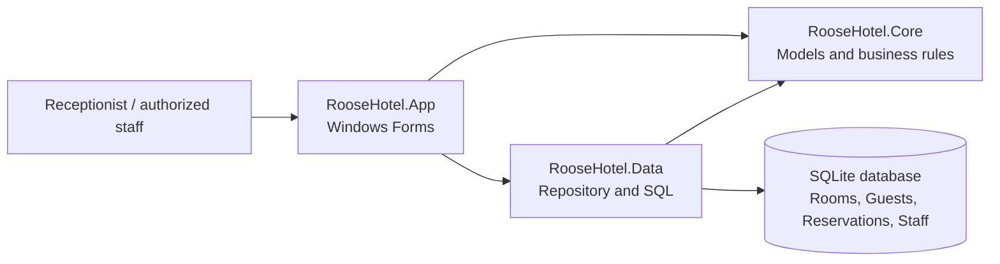
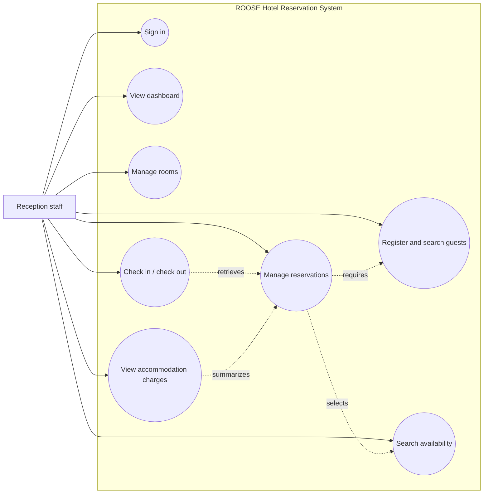
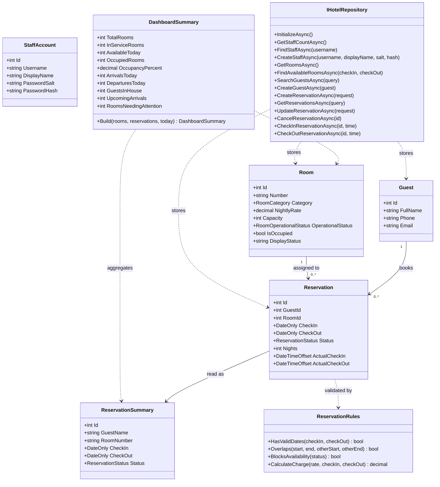
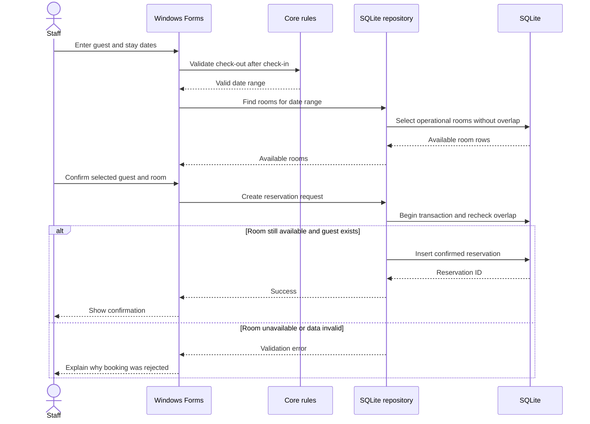
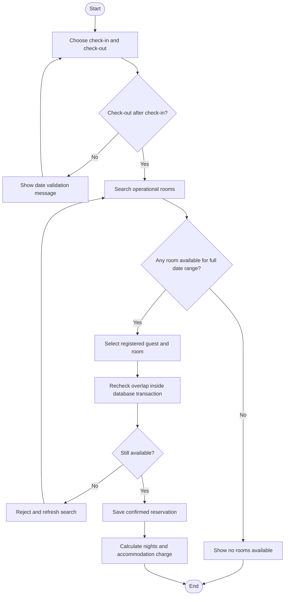
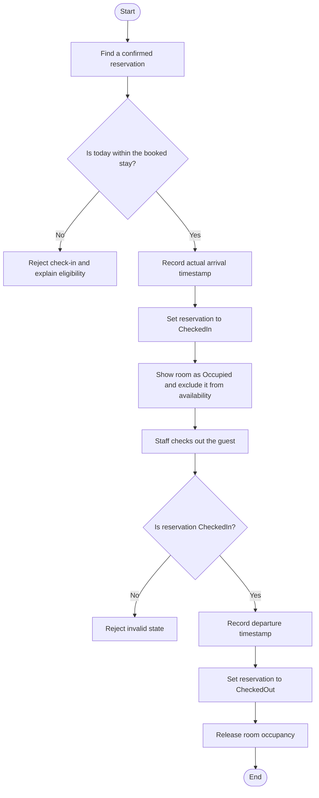
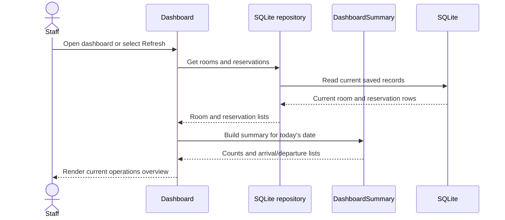

# System Models and Software Design

## 1. Architecture

The application follows a three-layer architecture. Windows Forms handles display and user input. Core contains the entities and validation rules. Data implements persistence using ADO.NET and SQLite. Each layer has a narrow responsibility so UI changes do not require rewriting the database logic.

## 2. Use-case model

## 3. Core class model

## 4. Reservation sequence

## 5. Booking activity

## 6. Data design notes

`Rooms` stores room identity, category, nightly rate, capacity, and operational status. The UI derives the `Occupied` display state from a reservation in `CheckedIn`; occupancy remains separate from operational state. `Guests` stores contact records. `Reservations` references one guest and one room, stores ISO `yyyy-MM-dd` booked dates, a status, and nullable actual check-in/check-out timestamps. `Staff` stores a unique username, display name, and password salt/hash; it never stores the entered password. Foreign keys are enabled. The date overlap rule is `existing.CheckIn < requested.CheckOut AND requested.CheckIn < existing.CheckOut`; adjacent stays therefore do not conflict.

`DashboardSummary` is a read-time aggregate of persisted rooms and reservations. It is rebuilt whenever staff open or refresh the dashboard; there is no separate cached dashboard record to become stale.

The first run creates the initial staff account. Passwords are hashed with PBKDF2-SHA256 and a random per-account salt. Room assignments and the fourth category's name/rate remain group-confirmation items.

## 7. Check-in and check-out activity

## 8. Dashboard refresh sequence

